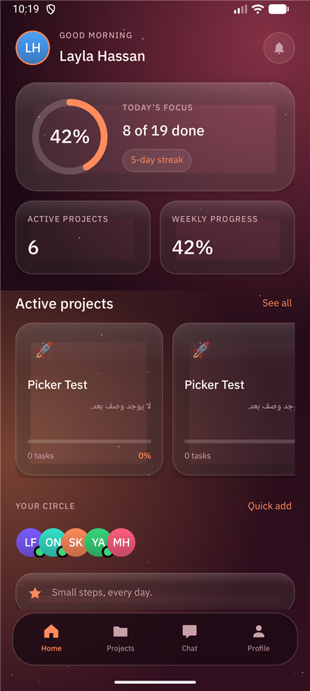
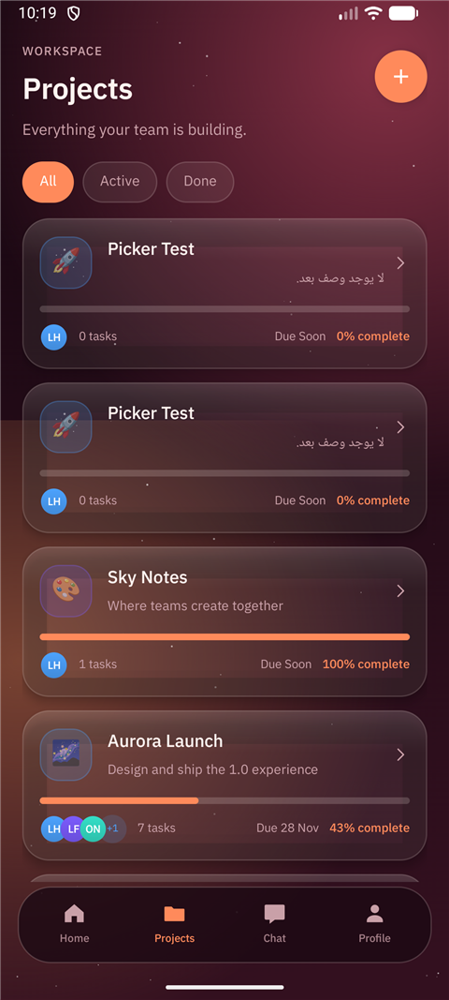
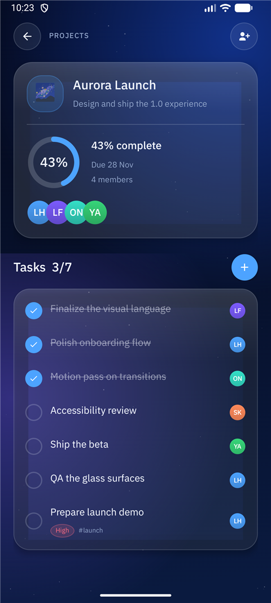
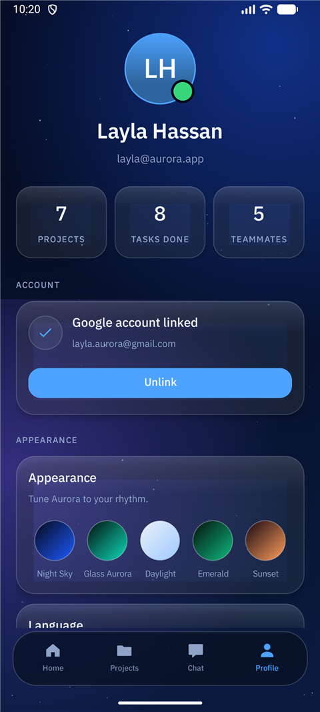

# Aurora · أورورا

**A native Android workspace for projects, tasks and team conversations.**
Offline-first, bilingual (English / العربية), five hand-tuned themes.

**مساحة عمل أندرويد أصلية للمشاريع والمهام ومحادثات الفريق.** تعمل بلا إنترنت،
بلغتين (العربية / English)، وبخمسة ثيمات مصمّمة يدويًا.

[](https://github.com/yassinadel3843-dot/Aurora/releases/latest)
[](https://github.com/yassinadel3843-dot/Aurora/releases/latest)

| Home | Projects | Project detail | Profile |
|---|---|---|---|
|  |  |  |  |

---

## English

### Download

1. Open the [latest release](https://github.com/yassinadel3843-dot/Aurora/releases/latest).
2. Download `aurora-<version>.apk`.
3. Open the file and allow installation from this source when Android asks.

Requires **Android 5.0 (API 21)** or newer. Roughly 5 MB. No account, no sign-up,
no Play Store needed.

### Updates install themselves

Aurora checks GitHub Releases **once a day** in the background. When a newer
version exists you get a notification; tapping **Download & install** fetches the
APK and opens Android's installer. You can also check on demand:
**Profile → About Aurora → Check for updates**.

Honest limitation: Android never lets an app install another APK silently. Aurora
does everything except the final confirmation tap — the system shows its own
"Install" screen (and, on Android 8+, a one-time "allow installs from this app"
permission). That is the closest a GitHub-distributed app can get, and it is why
there is no fake "installed automatically" claim here.

### What Aurora actually does

- **Projects** — create a project with its own icon and colour, add tasks with
  due dates, priorities and tags, tick them off, and watch the progress bar and
  percentage follow along. Filters: All / Active / Done.
- **Project detail** — task list, completion counters, team members with roles
  and presence dots, invite sheet with a ready-to-send message.
- **Conversations** — individual and group threads, unread counters, message
  history per thread, and instant search across titles, previews, member names
  and message text.
- **Team** — six seeded teammates with roles and presence, initials avatars.
- **Profile** — account card, device Google account link/unlink, five themes,
  language switch (System / English / العربية) with a full RTL flip, notification
  and haptics switches, about, sign out.
- **Themes** — Night Sky (default), Glass Aurora, Daylight, Emerald, Sunset. Every
  screen recolours instantly; glass surfaces, canvas-drawn starfield and a
  progress ring are all custom views, no heavy libraries.
- **Screen sizes** — phones stay edge-to-edge; from 600dp the content becomes a
  centred 720dp column and project lists become two columns, so tablets and
  landscape phones are not stretched.
- **Local storage** — everything is JSON in `SharedPreferences`; no server, no
  Room, no account required. Data survives restarts and stays on the device.

### What Aurora does **not** do

Stated plainly so nothing on this page is aspirational:

- No cloud sync and no multi-device accounts — data lives on one device.
- No real-time collaboration: chat messages are stored locally, they are not
  delivered to other phones.
- Google linking uses the Google account already on the device (Android
  `AccountManager`); it is not OAuth sign-in and gives the app no cloud access.
- No web, desktop or iOS build. This repository is the Android app.
- Not on Google Play; releases are APKs published here.
- The five-day streak on Home is seeded demo data, not a computed streak.
- First launch ships demo content (projects, teammates, conversations) so the app
  is not empty; it is ordinary local data you can edit.

### Build from source

Requirements: Android Studio (or JDK 17 + Android SDK with platform 37 and build
tools 36.0.0).

```bash
export JAVA_HOME="/path/to/jbr"          # Android Studio's bundled JDK
export ANDROID_HOME="$HOME/Android/Sdk"
./gradlew :app:assembleDebug
# → app/build/outputs/apk/debug/app-debug.apk
```

Unit tests: `./gradlew :app:testDebugUnitTest` (13 tests: dates, models,
version comparison and release parsing).

Release builds are signed from `keystore.properties` (local) or the
`AURORA_*` environment variables (CI). Without either, the build falls back to
the debug key so a fresh clone still produces an installable APK.

### Project layout

```
app/src/main/java/com/aurora/workspace/
├── data/      Models, SeedData, Store (the single source of truth, JSON persistence)
├── theme/     ThemeManager (5 themes), LocaleHelper (language + RTL)
├── util/      NotificationHelper, UpdateChecker, UpdateInstaller, GoogleAccountHelper, ScreenFit
├── widgets/   AuroraBackgroundView, GlassCard, ProgressRingView, AvatarView
└── ui/        Auth, Main (4 glass tabs), ProjectDetail, Chat + home/projects/chat/profile
```

### Releasing

Tag `v<versionName>`, push the tag, and `.github/workflows/release.yml` builds the
signed APK and publishes it as a GitHub release. The workflow refuses to run when
the tag and `versionName` disagree, or when the signing key secret is missing —
a mismatched key would break every installed copy. Details in
[`.github/workflows/release.yml`](.github/workflows/release.yml).

### Privacy

See [PRIVACY.md](PRIVACY.md). Short version: nothing leaves the device except one
optional daily request to the public GitHub API that asks for the latest release
number.

### License

All rights reserved. The source is published so the app can be inspected and
built; it is not licensed for redistribution or derivative releases. Open an
issue if you want a different arrangement.

---

## العربية

### التنزيل

1. افتح [أحدث إصدار](https://github.com/yassinadel3843-dot/Aurora/releases/latest).
2. نزّل الملف `aurora-<الإصدار>.apk`.
3. افتح الملف واسمح بالتثبيت من هذا المصدر عندما يسألك أندرويد.

يحتاج **أندرويد 5.0 (API 21)** أو أحدث، وحجمه نحو 5 ميجابايت. بلا حساب وبلا
تسجيل وبلا متجر.

### التحديث يثبّت نفسه

أورورا يسأل GitHub Releases **مرة واحدة يوميًا** في الخلفية، وعند وجود إصدار أحدث
يظهر إشعار؛ والضغط على **تنزيل وتثبيت** ينزّل ملف APK ويفتح مثبّت أندرويد. ويمكنك
التحقق يدويًا من **حسابي ← عن أورورا ← التحقق من التحديثات**.

**حدّ صريح:** أندرويد لا يسمح لأي تطبيق بتثبيت APK آخر بصمت. أورورا يفعل كل شيء
عدا نقرة التأكيد الأخيرة — شاشة «تثبيت» من النظام (ومع أندرويد 8+ إذن لمرة واحدة
بتثبيت التطبيقات من هذا التطبيق). هذا أقصى ما يمكن لتطبيق يوزّع عبر GitHub، ولذلك
لا يوجد ادعاء زائف بأن التحديث «يُثبَّت تلقائيًا».

### ما يفعله أورورا فعلًا

- **المشاريع** — إنشاء مشروع بأيقونة ولون خاصين، إضافة مهام بتاريخ استحقاق
  وأولوية ووسم، تعليمها كمنجزة، وتحديث شريط التقدّم والنسبة فورًا. الفلاتر:
  الكل / نشط / مكتمل.
- **تفاصيل المشروع** — قائمة المهام وعدّاداتها، أعضاء الفريق بأدوارهم وحالة
  الاتصال، ونافذة مشاركة برسالة دعوة جاهزة.
- **المحادثات** — محادثات فردية وجماعية، عدّاد غير مقروء، سجل رسائل لكل محادثة،
  وبحث فوري في العناوين والمعاينات وأسماء الأعضاء ونصوص الرسائل.
- **الفريق** — ستة أعضاء ببيانات أولية بأدوار وحالة اتصال وصور بالأحرف.
- **حسابي** — بطاقة الحساب، ربط/فصل حساب Google الموجود على الجهاز، خمسة ثيمات،
  تبديل اللغة (النظام / English / العربية) بانعكاس RTL كامل، مفاتيح الإشعارات
  والاهتزاز، عن أورورا، وتسجيل الخروج.
- **الثيمات** — Night Sky (الافتراضي)، Glass Aurora، Daylight، Emerald، Sunset.
  كل شاشة تتلوّن فورًا، والأسطح الزجاجية وخلفية النجوم وحلقة التقدّم كلها عناصر
  مرسومة مخصّصًا بلا مكتبات ثقيلة.
- **مقاسات الشاشات** — الهواتف تبقى حافة إلى حافة؛ ومن 600dp يصبح المحتوى عمودًا
  مركزيًا بعرض 720dp وقوائم المشاريع عمودين، فلا يتمدّد التابلت والهاتف الأفقي.
- **تخزين محلي** — كل شيء JSON داخل `SharedPreferences`؛ بلا سيرفر وبلا Room
  وبلا حساب. البيانات تبقى بعد إعادة التشغيل وعلى الجهاز وحده.

### ما **لا** يفعله أورورا

مكتوب بصراحة حتى لا يكون في هذه الصفحة أي وعد نظري:

- لا مزامنة سحابية ولا حساب متعدّد الأجهزة — البيانات على جهاز واحد.
- لا تعاون لحظي: رسائل المحادثة تُحفظ محليًا ولا تُسلَّم لهواتف أخرى.
- ربط Google يستخدم الحساب الموجود على الجهاز عبر `AccountManager`، وليس
  تسجيل دخول OAuth، ولا يمنح التطبيق أي وصول سحابي.
- لا توجد نسخة ويب ولا سطح مكتب ولا iOS. هذا المستودع هو تطبيق أندرويد.
- ليس على Google Play؛ الإصدارات ملفات APK تُنشر هنا.
- «سلسلة 5 أيام» في الشاشة الرئيسية بيانات تجريبية ثابتة، ليست محسوبة.
- أول تشغيل يزرع محتوى تجريبيًا (مشاريع وفريق ومحادثات) حتى لا يبدأ التطبيق
  فارغًا؛ وهو بيانات محلية عادية قابلة للتعديل.

### البناء من المصدر

المتطلبات: Android Studio (أو JDK 17 مع Android SDK فيه المنصّة 37 وbuild tools
36.0.0).

```bash
export JAVA_HOME="/path/to/jbr"          # JDK المرفق مع Android Studio
export ANDROID_HOME="$HOME/Android/Sdk"
./gradlew :app:assembleDebug
# ← app/build/outputs/apk/debug/app-debug.apk
```

اختبارات الوحدة: `./gradlew :app:testDebugUnitTest` (13 اختبارًا: التواريخ
والنماذج ومقارنة الإصدارات وقراءة رد GitHub).

نسخة الإصدار تُوقَّع من `keystore.properties` محليًا، أو من متغيّرات البيئة
`AURORA_*` في CI. وبدون أيهما يعود البناء لمفتاح التصحيح كي يظل المستودع قابلًا
لبناء APK قابل للتثبيت.

### الإصدارات

أنشئ وسمًا `v<versionName>` وادفعه؛ يبني `.github/workflows/release.yml` ملف APK
موقّعًا وينشره كإصدار GitHub. والـ workflow يرفض العمل إذا اختلف الوسم عن
`versionName` أو غاب مفتاح التوقيع — لأن مفتاحًا مختلفًا يكسر كل نسخة مثبّتة.

### الخصوصية

راجع [PRIVACY.md](PRIVACY.md). باختصار: لا شيء يغادر الجهاز سوى طلب يومي اختياري
إلى GitHub API العام يسأل عن رقم أحدث إصدار.

### الترخيص

جميع الحقوق محفوظة. المصدر منشور ليُفحص ويُبنى، وليس مرخّصًا لإعادة النشر أو
إصدار نسخ مشتقّة. افتح issue لو أردت ترتيبًا آخر.
